<p align="center">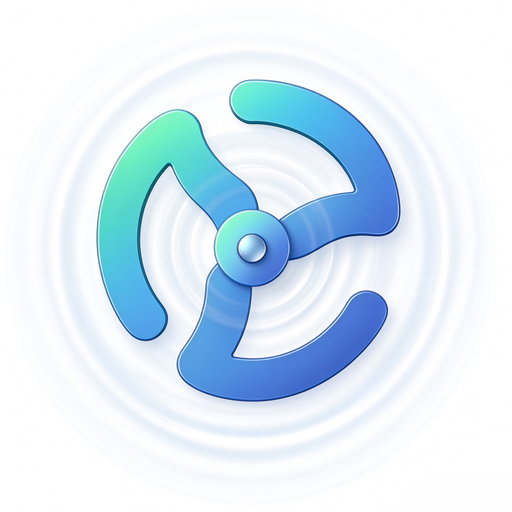</p>

<h1 align="center">SxDevOps · v2</h1>

<p align="center"><strong>面向运维现场的开源智能运维 Agent 平台</strong></p>

<p align="center"><strong>思而后行，行必有证。</strong></p>

<p align="center">
  <a href="https://github.com/aiyiyi121/sxdevops/releases/tag/v2.0.0"></a>
  <a href="LICENSE"></a>
  <a href="docs/AIOps-LangGraph-试点说明.md"></a>
</p>

<p align="center">
  
  
  
  
  
</p>

<p align="center">
  
  
  
  
  
</p>

**产品体验：进入平台，体验智能运维工作台 → [https://www.sxdevops.top](https://www.sxdevops.top)**

**产品介绍：了解平台能力、产品界面与工作流程 → [https://www.sxdevops.top/product](https://www.sxdevops.top/product)**

**文档中心：查看安装、使用与部署文档 → [https://github.com/aiyiyi121/sxdevops/blob/main/docs/README.md](https://github.com/aiyiyi121/sxdevops/blob/main/docs/README.md)**

SxDevOps 是一个面向真实运维现场的开源智能运维 Agent 平台。它把 **CMDB、可观测性、事件中心、任务中心、工单审批、容器管理、RBAC** 等平台能力组织成 Agent 可调用、可审计、可确认的运维工作流。

项目不是简单做一个聊天框，而是希望让运维从“到处查系统”升级为：

> 看态势、找证据、问系统、确认动作。

## 目录

| 了解产品 | 能力与演示 | 安装与维护 |
| --- | --- | --- |
| [v2 重点更新](#v2-重点更新) | [核心能力](#核心能力) | [快速启动](#快速启动) |
| [为什么需要它](#为什么需要它) | [典型场景](#典型场景) | [账号与升级](#账号与升级) |
| [产品定位](#产品定位) | [Agent 工作机制](#agent-工作机制) | [项目结构](#项目结构) |
| [技术栈](#技术栈) | [产品截图](#产品截图) | [文档导航](#文档导航) |
| [架构概览](#架构概览) | [后续方向](#后续方向) | [贡献与安全](#贡献与安全) · [开源协议](#开源协议) |

<p align="center"></p>

## v2 重点更新

v2 围绕 **CMDB 资产底座、LangGraph 智能体编排、容器管理工作台** 完善从资源、取证、人工确认到执行验证的链路。平台版本使用 `v2.0.0`；文档中的聊天图 v12、动作图 v1 和验证图 v1 是内部流程版本，与平台发行版本分别管理。

| 方向 | 本版能力与调整 |
| --- | --- |
| CMDB | 统一资产、资源树、容量水位、同步与治理入口；任务中心显式接入 CMDB 资产；最新指标查询与历史聚合优化；拓扑支持精确范围及 1–3 跳邻居 |
| AIOps / LangGraph | 默认聊天进入持久化图编排；分阶段取证、工具循环、任务草稿和回复修复；独立 worker、checkpoint 恢复、租约与节点审计；处置后告警恢复验证 |
| 能力配置 | 六类问答入口、十三个内置可复用 Skill；统一能力挂载与 MCP 工具依赖展示，减少重复配置 |
| 容器管理 | 统一 Kubernetes / Docker 工作台；资源与 YAML 预检、范围授权、容量摘要、容器与镜像分页搜索、交互终端及历史日志 |
| 工作台体验 | 浅色、炭灰、深蓝灰三套主题；侧栏集中导航与工具入口，内容区自适应铺满；系统设置统一管理网站名称、图标、菜单排序与显示 |

### CMDB：资产与执行资源衔接

- 资产台账、资源搜索、业务线/环境树、同步中心、容量水位和治理使用统一资源口径；云账号、vSphere、机房资产及第三方服务按模板纳管。
- 任务中心提供“从 CMDB 接入”和“手工添加”。CMDB 资产须经选择、补充执行信息并保存后才成为任务资源；沿用已有名称、IP、负责人、SSH 用户和端口，执行密码单独维护。
- 已接入资产的基础信息与归属随 CMDB 更新；源资产停机、下线或删除时阻止新的关联资源任务执行。移除执行资源保留源资产，历史手工资源和任务引用保持原有 ID。
- 容量、水位与治理读取每项资产、每种指标的最新快照，历史均值下推数据库聚合，减少历史指标增长带来的应用内存开销。
- 拓扑可选择仅命中节点或带 1、2、3 跳邻居，始终限定授权资产；图例只展示当前画布实际出现的资产类型与关系。

详见 [CMDB 使用手册](docs/CMDB使用手册.md)和[任务资源底座与 CMDB 接入](docs/task-resource-cmdb.md)。

### AIOps：LangGraph 编排、恢复与验证

- 默认聊天采用 LangGraph，告警根因、K8s 异常、服务异常、环境告警、变更关联、自愈建议、SLO 分析等按阶段保存证据；通用模型规划、单次工具执行、任务草稿和回复整形也有独立节点。
- 异步任务由数据库队列和独立 worker 处理，支持租约接管及从 checkpoint 继续未完成阶段；恢复时重新检查权限、MCP 和原始范围。节点内中断仍可能重试当前请求，外部工具需要幂等。
- 关键写入沿用 Django 的权限、预检与人工确认。动作确认图记录检查、人工等待和执行，LangGraph 不直接绕过平台 API 操作资源。
- 回复整形增加事实检查、有界修复及兜底；无数据、查询失败与权限不足明确显示为证据限制，不能据此宣称服务健康。
- 智能体审计串联会话、图节点、MCP、模型调用和动作；展示耗时、失败、恢复、查询重试、checkpoint 与兼容降级状态。
- 处置效果验证在任务执行前保存活跃告警基线，任务完成并经过观察窗口后检查同一告警恢复事件；区分“告警已恢复”“验证未通过”和“证据不足”，提供六组可重复评测的模拟样本。
- 六类问答入口与十三个内置 Skill 共用服务端目录；能力侧维护 Skill 挂载，MCP Server 维护工具配置，界面自动展示依赖关系。

处置验证目前只说明观察到告警恢复，不能证明操作因果或业务整体健康；指标持续达标与多信号验证仍待扩展。

详见 [LangGraph 实现与运行说明](docs/AIOps-LangGraph-试点说明.md)、[问答能力与 Skills](docs/AIOps-问答能力与Skills.md)和[处置效果验证](docs/AIOps-处置效果验证.md)。

### 容器管理：工作台、终端与日志

- **Kubernetes 资源操作**：完善 Service、Ingress、Endpoints、IngressClass、NetworkPolicy、HPA、ResourceQuota 和 LimitRange 等资源入口；YAML 创建/编辑先 dry-run 预检和差异确认，再应用到集群。
- **范围授权**：平台 RBAC 作为能力上限，再叠加用户集群、命名空间及终端授权；资源 API、WebSocket、任务中心与 AIOps 查询共同检查范围。
- **容量与性能**：展示 CPU / 内存实际用量、Requests、Limits 和可分配容量；缺少 metrics 时明确显示不可用。列表按页挂载、查询合并、忽略过期请求，容量按需采集并短缓存。
- **Docker 操作体验**：环境卡片与概要联动，容器/镜像分页搜索；切换环境保留上下文，操作前明确目标并确认，自动刷新可选且在后台页面或弹窗期间暂停。
- **交互终端**：K8s 集群、Pod 和 Docker 容器支持 Shell 选择、全屏、重连、复制粘贴及会话下载；Tab 交给实际 Shell，补全能力遵循环境已有工具。
- **历史日志**：首次读取最近 500 行，按游标继续翻阅历史，浏览器最多保留三页；展示原始日志，不额外叠加时间戳，服务端限制采集大小并回收临时文件。

详见 [K8s 工作台与用户授权](docs/K8s工作台与用户授权.md)和[Docker 工作台](docs/Docker工作台.md)。

## 为什么需要它

传统运维现场里，信息和动作经常被拆散：

- 告警中心看到红点，但日志、Trace 和最近变更在别的系统里。
- 发布、审批、任务执行、失败结果和关键操作散落在不同页面，复盘成本高。
- 巡检、批量命令、脚本模板和主机权限脱节，动作入口不统一。
- 排障经验依赖个人记忆，结论难沉淀，下一次仍要重新查。

SxDevOps 的目标是把这些碎片化能力收敛成一条链路：**可观测性取证，事件中心复盘，任务中心行动，AIOps 负责理解、规划和结构化输出**。

## 产品定位

SxDevOps AI Agent = **可观测性 + 事件中心 + 任务中心 + AIOps**

| 层次 | 说明 |
| --- | --- |
| 可观测性事实层 | 聚合告警、指标、日志、Trace、Grafana 和系统态势，形成 Agent 可查询的证据来源。 |
| 事件中心 | 沉淀最终执行结果、关键写操作、失败定位线索和复盘上下文。 |
| 任务中心 | 承接主机巡检、批量命令、脚本模板、任务草稿、执行历史和计划任务。 |
| AIOps 智能体 | 使用 LLM 做理解与规划，使用 MCP 工具取数，使用 Skill 约束输出，使用后端完成权限、确认、执行和审计。 |

一句话理解：

**模型负责理解，平台负责边界；Agent 可以分析和生成草稿，但关键动作必须通过权限校验和人工确认。**

## 核心能力

| 模块 | 能力 |
| --- | --- |
| CMDB | 资产台账、业务资源树、同步纳管、容量水位、治理与拓扑、任务资源显式接入 |
| AIOps 智能体 | LangGraph 编排与恢复、自然语言取证、Skill、任务草稿、人工确认、执行审计与处置效果验证 |
| 可观测性 | 平台总览、系统态势、指标查询、日志检索、链路追踪、Grafana 看板承接、数据源管理 |
| 事件中心 | 失败事件定位、关键操作沉淀、事件源接入、操作审计、按系统/环境/应用/时间过滤 |
| 任务中心 | 主机任务、批量命令、脚本模板、资源分组、任务草稿、执行历史、计划任务 |
| 工单系统 | 应用发布、审批流、SQL 审计、事务工单、变更留痕 |
| 容器管理 | Kubernetes / Docker 工作台、资源与 YAML 预检、范围授权、容量、交互终端与历史日志 |
| 权限与审计 | 后端 API、前端路由、菜单、按钮和 WebSocket 场景统一接入 RBAC |

## 典型场景

以“生产 order-center 异常分析”为例。

传统方式通常要人工切换多个系统：

1. 打开告警平台看 PromQL、标签和触发时间。
2. 到日志中心查错误关键字和上下文。
3. 到链路追踪定位慢调用和异常 Span。
4. 翻最近发布、任务、审批和事件记录。
5. 手工整理结论和下一步动作。

在 SxDevOps 里，可以让 Agent 串起这条链路：

1. 用户用自然语言发起分析。
2. Agent 选择告警、日志、Trace、事件中心、任务中心等工具。
3. 后端按白名单执行工具调用，并做 RBAC、参数清洗和超时控制。
4. 平台汇总结构化证据，Skill 输出结论、依据、风险和建议操作。
5. 如需巡检或命令执行，先生成任务草稿，用户确认后才进入任务中心。
6. 执行结果继续回写事件中心和审计链路；提前配置告警基线的任务可继续验证恢复结果。

## Agent 工作机制

SxDevOps 的 Agent 运行逻辑不是“用户提问 -> 大模型自由回答”，而是一套受控编排链路：**Action Router 先判断任务类型，Agent Mode 决定推理方式，Preflight 守住执行边界，Skill/SOP 约束专业过程，MCP 连接外部与平台工具，最终由审计和反馈闭环沉淀结果**。

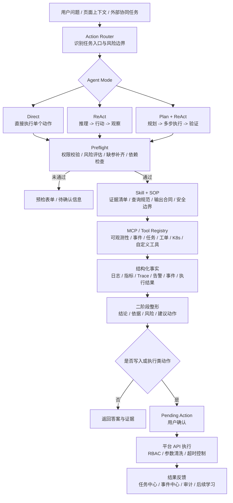

这条链路里几个核心概念的职责是：

| 层次 | 职责 |
| --- | --- |
| Action Router | 识别本次问题属于告警根因、日志查询、K8s 诊断、变更关联、任务生成等哪类 Action，并声明风险等级、所需上下文、输出结构和确认策略。 |
| Agent Mode | 按任务复杂度选择执行方式：`Direct` 适合单步只读或明确动作，`ReAct` 适合边查边判断，`Plan + ReAct` 适合多步骤深度排障和协同任务。 |
| Preflight | 在进入写入、生成或执行前做权限校验、风险评估、依赖检查、缺参补齐和回滚就绪检查；不满足条件时返回预检表单或待确认信息。 |
| Skill / SOP | 沉淀领域能力包，约束证据清单、查询规范、判断规则、输出格式和安全边界，避免模型自由发挥。 |
| MCP / Tool Registry | 把平台能力和外部系统封装成可治理工具，最终可用工具由 `Skill 工具依赖 ∩ MCP 可用性 ∩ 用户 RBAC ∩ Action 安全策略` 决定。 |
| Pending Action | 所有写入和执行类动作先变成待确认动作，用户确认后才由平台 API 执行。 |
| 审计与反馈 | 会话、工具调用、预检、待确认动作、执行结果和关键事件都会留痕，执行结果继续回写任务中心和事件中心。 |

当前实现遵循几个原则：

- 平台 API 是唯一执行边界，模型只负责理解、规划和生成候选参数，不能绕过后端直接操作资源。
- Action 负责“任务入口和流程策略”，Skill 负责“能力包和专业约束”，两者不混在一起。
- 只读诊断可以直接返回事实；生成、写入、执行类动作必须先预检、再确认、再执行。
- Preflight 不是装饰步骤，而是权限、风险、依赖、缺参和回滚检查的统一入口。
- 前端展示权限只是体验优化，后端 RBAC 才是安全边界。
- 会话、工具调用、Action 预检、待确认动作、执行结果和关键事件都要留痕。

## 产品截图

### 系统态势

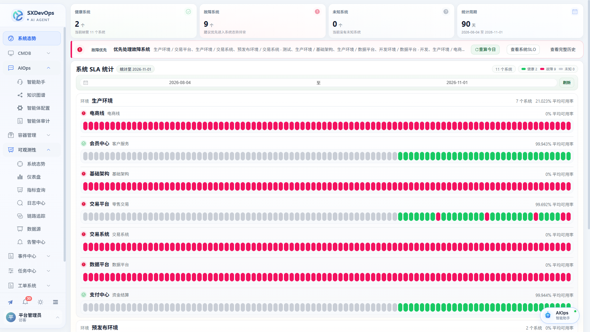

### AI Agent

默认聊天支持分阶段取证和断点恢复，执行追踪可查看节点与动作结果。

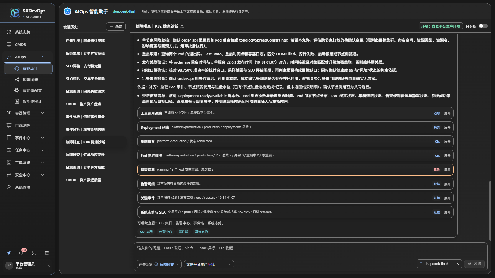

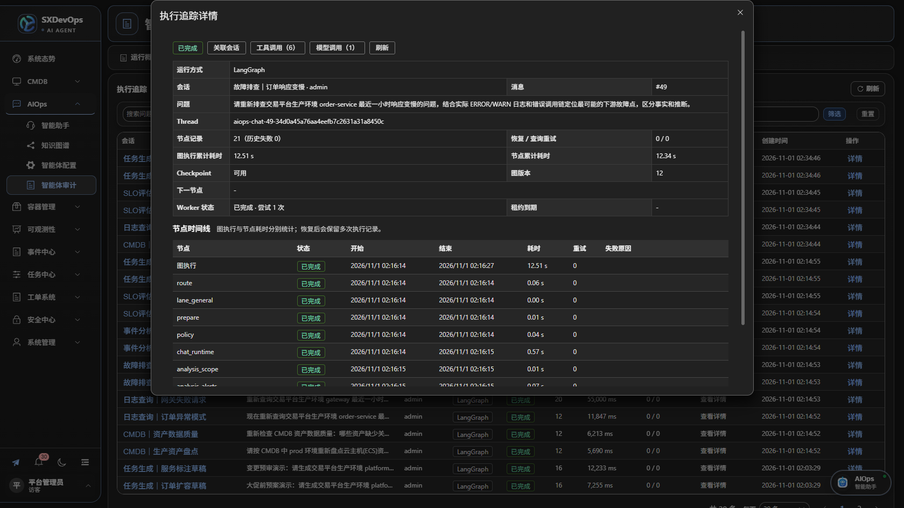

### CMDB 资产与拓扑

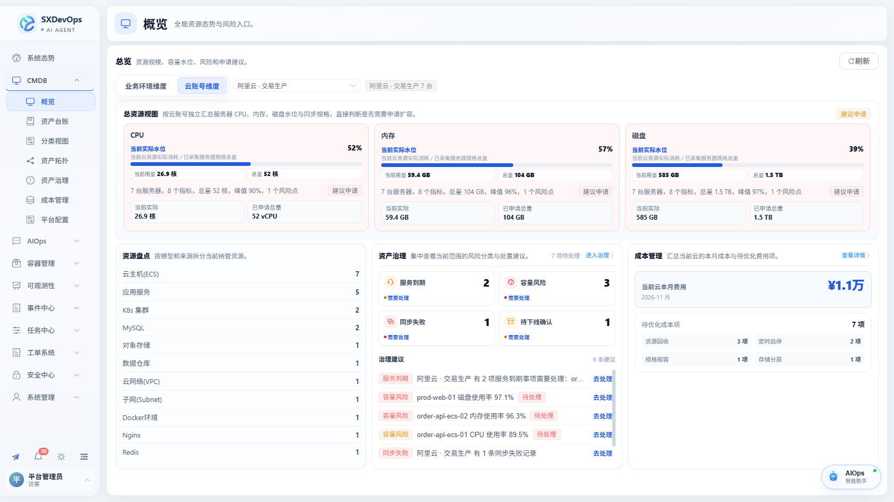

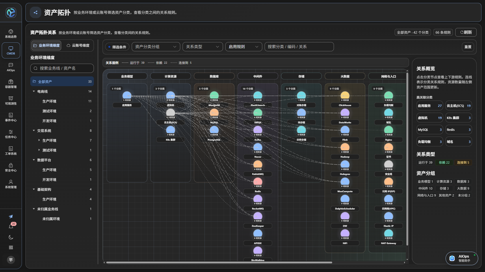

### 容器管理

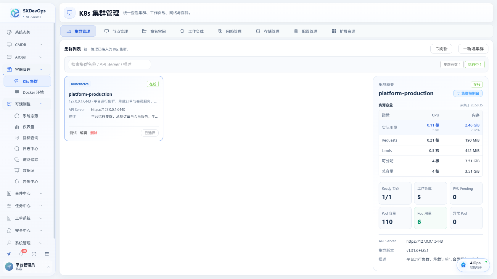

### 日志与链路追踪

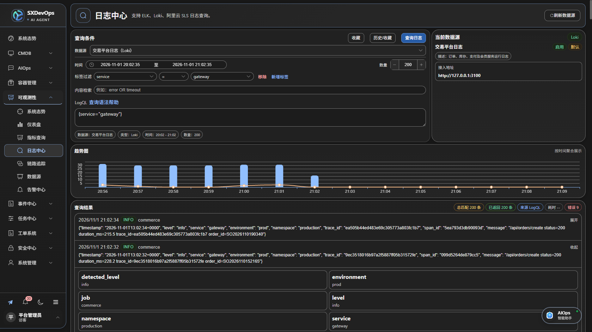

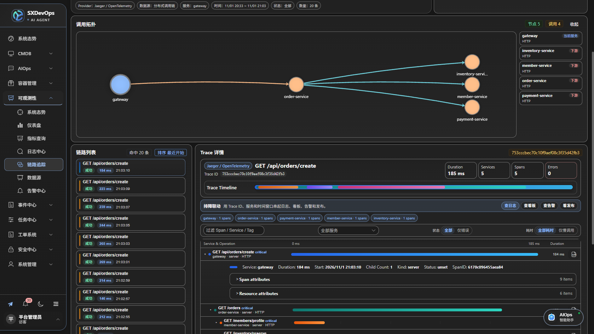

### 系统 SLO 与仪表盘

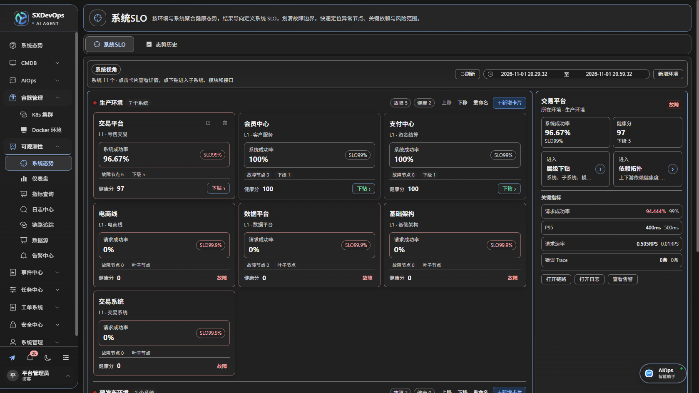

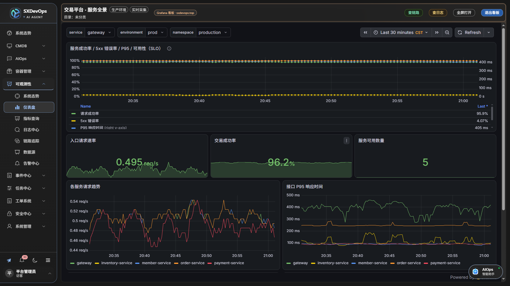

### 事件中心

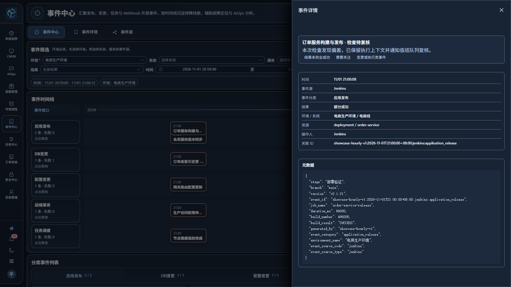

更多截图保存在 [docs/screenshots](docs/screenshots)。

## 技术栈

| 层级 | 技术 |
| --- | --- |
| 后端 | Django REST framework、Channels、Daphne |
| 智能体编排 | LangGraph、PostgreSQL / MySQL / SQLite checkpoint、数据库任务队列与独立 worker |
| 前端 | Vue 3、Vue Router、Pinia、Element Plus、ECharts、Vite |
| 数据库 | 新部署默认 PostgreSQL 16（推荐），MySQL 8 可选；本地测试使用 SQLite |
| 缓存与实时通信 | Redis、Channels Redis |
| 外部集成 | Kubernetes API、Docker、SSH、Prometheus / Grafana、SkyWalking、Tempo、Jaeger、Zipkin、Loki / ELK / SLS |

## 架构概览

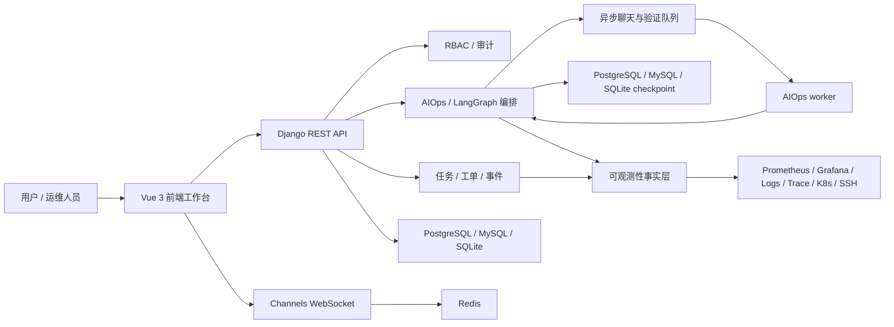

## 快速启动

安装并启动 Docker（v20.10及以上均可，要求含 Docker Compose V2），在仓库根目录执行一条命令：

```bash
sh start.sh
```

Windows 用户执行 `.\start.cmd`，也可以直接双击 `start.cmd`。

脚本会自动生成并保存密钥、构建镜像、启动应用 / PostgreSQL / Redis / CMDB 调度器 / AIOps worker，并完成数据库迁移。**首次只需按提示输入并确认 `admin` 密码**，不需要手工创建 `.env` 或生成密钥。

启动完成后打开 [平台登录页](http://localhost:8000/login)，用户名为 `admin`，密码为刚才自行设置的密码。已有管理员时沿用原账号和密码；平台没有固定默认密码，演示数据默认关闭。

再次启动执行同一命令即可，脚本会保留现有配置和账号。自动生成的 `.env` 请妥善备份，升级时沿用原密钥；完整步骤与手动配置见[快速开始](docs/getting-started.md)。忘记 `admin` 密码时可交互重设：

```bash
docker compose exec sxdevops python manage.py changepassword admin
```

新部署默认使用 **PostgreSQL 16（推荐）**，数据库密码自动生成并保存在 `.env`；本地测试环境仍用 SQLite，无需迁移。MySQL 8 作为备选：Linux / macOS 执行 `sh start.sh --mysql`，Windows 执行 `.\start.cmd -Database mysql`，对应独立的 [MySQL Compose 配置](docker-compose.mysql.yml)。已有 MySQL 环境继续用此选项，切换数据库类型不会自动迁移业务数据或 checkpoint。

公网部署前按[配置参考](docs/configuration.md)与[部署运维指南](docs/deployment.md)调整。

本地开发使用 Python 3.12、Node.js 20，按[快速开始](docs/getting-started.md#本地开发)启动后端、前端和 worker；在 `backend` 目录执行 `python manage.py createsuperuser --username admin` 创建管理员，再通过 [本地开发登录页](http://localhost:3000/login)使用自行设置的密码登录。

Kubernetes 已准备好集群可拉取的应用镜像时，在任意可连接目标集群的电脑或跳板机上执行（将示例镜像替换为自己的固定版本镜像；执行机需 Python 3、`kubectl` 及本仓库源码）：

```bash
python3 k8s/deploy.py registry.example.com/your-team/sxdevops:v2.0.0
```

可追加 `--kubeconfig ./kubeconfig --context production` 指定远程集群；省略时沿用 kubectl 默认配置。脚本在目标集群创建随机密钥、配置共享 PostgreSQL / Redis / checkpoint、执行迁移并启动 Web、CMDB 调度器和 AIOps worker，首次按提示设置 `admin` 密码，随后打开执行机上的本地访问隧道。Windows 将 `python3` 换为 `python`。新安装可追加 `--database mysql` 选择 MySQL；已有安装会保留原数据库类型，拒绝直接切换引擎。存储类、私有仓库与升级选项见[集群部署指南](docs/Kubernetes部署指南.md)。

## 账号与升级

`seed_data` 仅导入隔离环境中的业务演示数据，不创建登录账号。`seed_rbac_demo` 需显式运行，仅用于测试角色；不设置密码时生成随机值但不打印，具体行为见[演示数据与测试角色](docs/getting-started.md#演示数据与测试角色)。

旧 `demo`、`demo_ai` 的用户名特权已移除，升级迁移会清理账号、Token、会话及账号所属聊天副本。升级前备份数据库、checkpoint 与原加密密钥，并让应用、调度器和 worker 同版本更新，见 [v2.0.0 升级说明](docs/releases/v2.0.0-release-guide.md)。

## 项目结构

```text
backend/             Django、业务模块、RBAC、AIOps 和管理命令
frontend/src/        Vue 页面、组件、路由、API 与状态
docs/                使用、配置、运维、安全、架构与版本说明
docker/              容器入口脚本
k8s/                 Kubernetes 基础部署示例
docker-compose.yml   本地源码构建与服务编排
Dockerfile           前后端一体镜像
```

## 文档导航

| 目标 | 入口 |
| --- | --- |
| 安装与配置 | [快速开始](docs/getting-started.md) · [配置参考](docs/configuration.md) |
| 部署、备份和排障 | [部署与运维](docs/deployment.md) · [Kubernetes](docs/Kubernetes部署指南.md) |
| 日常使用 | [用户指南](docs/用户使用文档.md) · [CMDB](docs/CMDB使用手册.md) · [任务资源](docs/task-resource-cmdb.md) |
| 智能体机制 | [AIOps 架构](docs/AIOps-LangGraph-试点说明.md) · [Skills](docs/AIOps-问答能力与Skills.md) · [处置验证](docs/AIOps-处置效果验证.md) |
| 权限与安全 | [账号与 RBAC](docs/user-permission-security.md) · [安全反馈](SECURITY.md) |
| 版本与贡献 | [更新说明](docs/releases/v2.0.0.md) · [验证记录及限制](docs/releases/v2.0.0-validation.md) · [贡献指南](CONTRIBUTING.md) |

更多专题见[文档目录](docs/README.md)。当前后端全量测试仍有已知失败，不能用专项通过代替全量结论；最近记录见版本验证说明。

## 后续方向

- 完善高频故障场景的证据质量、Skill 和真实案例评测。
- 增强 MCP 健康检查、工具发现、鉴权和超时诊断。
- 完善审批、Runbook、受控执行与回退的联动。
- 提高资源、环境、服务和观测数据的一致性。

以上是持续改进方向，具体范围以代码和版本说明为准。

## 贡献与安全

欢迎提交 Issue、文档修正或代码贡献。开发规范、测试和发布检查见 [CONTRIBUTING.md](CONTRIBUTING.md)。

对外部署应使用独立密钥、最小权限和隔离演示数据，不暴露真实执行资源或测试角色账号。代码整改不会自动解除 Chrome 安全告警，处理方式见[站点安全告警](docs/user-permission-security.md#站点安全告警处理)。漏洞请按 [SECURITY.md](SECURITY.md) 私密反馈。

## 开源协议

SxDevOps 使用 [MIT License](LICENSE)，允许使用、修改、分发和商业使用。分发软件副本或实质性部分时，需保留版权与许可声明；软件按原样提供，不提供担保。第三方依赖继续遵循各自许可证，分发时保留其要求的许可及声明文件。

## 关于项目与致谢

SxDevOps 是一个由个人独立维护的开源项目。从 UI 与架构设计，到功能开发、测试验证，主要依靠我的业余时间推进；模型调用所需的 Token 费用也由我个人承担。

受限于个人时间与精力，当前版本仍有不少需要打磨的地方。欢迎通过 [Issue](https://github.com/aiyiyi121/sxdevops/issues) 反馈问题、提出建议，也欢迎提交 [PR](https://github.com/aiyiyi121/sxdevops/pulls) 参与共建。我会在能力范围内持续维护、迭代新版本。

### 关注公众号

欢迎关注我的公众号。


### 最后感谢支持与传播

感谢阿铭老师对本项目的启发与宣传。如有大模型或 AIOps 学习需求，可通过 [铭科智联 · 跟阿铭学大模型/AIOps](https://www.amingedu.com/) 的公开渠道添加微信咨询。

感谢 [Agent2048](https://agent2048.com/zh/projects/2cmcyhvxsk4q) 对本项目的推广与展示。
